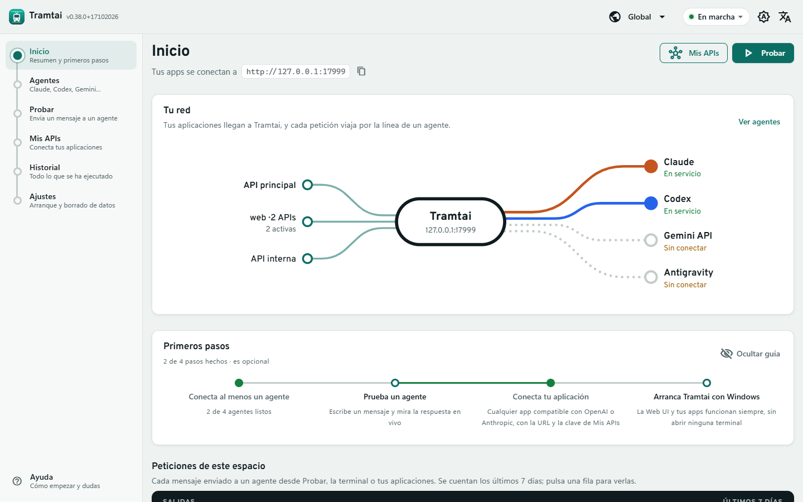
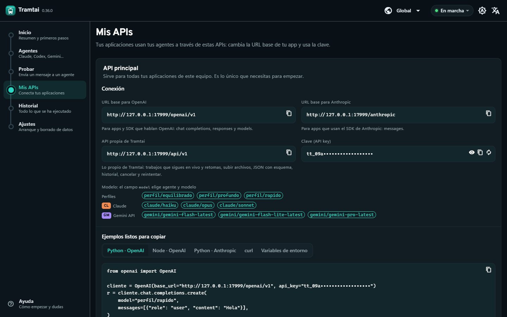

<div align="center">


# Tramtai

**Tus agentes de IA, como una API local.**

Tramtai convierte Claude Code, Codex, Gemini y Antigravity en una API compatible con OpenAI y Anthropic que funciona en tu propio equipo.<br>
Cualquier aplicación o SDK puede usarlos cambiando solo la URL base.

[](https://github.com/MscottB/Tramtai/actions/workflows/ci.yml)
[](https://github.com/MscottB/Tramtai/releases/latest)
[](https://github.com/MscottB/Tramtai/releases/latest)
[](LICENSE.md)

[**Descargar para Windows**](https://github.com/MscottB/Tramtai/releases/latest) · [Página del producto](https://mscottb.github.io/Tramtai/) · [Primeros pasos](docs/inicio.md) · [English](#english)

<br>



</div>

## Qué ofrece

- **Compatible con lo que ya usas.** SDK de OpenAI y Anthropic (Python, Node, curl…), con la respuesta en vivo, y una API propia con eventos que se pueden reanudar.
- **Agente y modelo en cada petición.** `claude/sonnet`, `codex`, `gemini/gemini-flash-latest` o un perfil como `perfil/rapido`; en Claude y Codex también eliges cuánto razona el agente.
- **Archivos y respuestas con forma.** PDF, Word, Excel, PowerPoint o ZIP como entrada; JSON validado con un esquema como salida.
- **Una API por aplicación,** con su propia clave, sus modelos permitidos o fijos e instrucciones propias (por ejemplo, «responde siempre en español»). Se activan o detienen sin reiniciar.
- **Tu suscripción o tu clave de API.** Claude y Codex se conectan con un clic a la sesión que ya tienes (uso personal) o con una clave.
- **Cuatro formas de usarlo** sobre los mismos trabajos: app de escritorio con icono en la bandeja, Web UI con ayuda integrada, terminal interactiva y línea de órdenes. En español y en inglés.
- **Local y privado.** Escucha solo en `127.0.0.1`, las claves van al Administrador de credenciales de Windows y los resultados caducan a las 24 horas. Sin telemetría.

## Empezar

1. **Descarga el instalador** `Tramtai-…-instalador-windows-x64.exe` desde [Releases](https://github.com/MscottB/Tramtai/releases/latest) y ejecútalo. Es solo para tu usuario y no pide permisos de administrador. Las sumas SHA-256 de cada archivo están en `SHA256SUMS.txt`. Si prefieres no instalar nada, `Tramtai-…-portable-windows-x64.zip` trae la misma app para descomprimir y usar (esa copia no se actualiza sola).
2. **Abre Tramtai** desde el menú Inicio. Queda en la bandeja del sistema con el servicio en marcha.
3. En la app, **Agentes** te dice qué le falta a cada agente (conectarlo con tu suscripción o con una clave) y **Mis APIs** te da la URL, la clave y ejemplos listos para copiar.

**En Linux** está la app completa, con su icono en la bandeja: descarga el `.deb` (Debian, Ubuntu, Mint…) o el `.rpm` (Fedora, openSUSE…) de [Releases](https://github.com/MscottB/Tramtai/releases/latest) e instálalo con `sudo apt install ./Tramtai-…-linux-amd64.deb` o `sudo dnf install ./Tramtai-…-linux-amd64.rpm`. Necesita GTK 4 y WebKitGTK 6.0, que se instalan solos (Ubuntu 24.04 o posterior, Debian 12 o posterior, Fedora).

**En macOS** descarga `Tramtai-…-macos.dmg` (Intel y Apple Silicon), ábrelo y arrastra Tramtai a Aplicaciones. La app no está firmada por un desarrollador de Apple, así que la primera vez macOS la bloquea: ábrela, cierra el aviso y ve a *Ajustes del Sistema → Privacidad y seguridad → Abrir igualmente* (o, en la Terminal, `xattr -dr com.apple.quarantine /Applications/Tramtai.app`). Después se abre con normalidad.

**Sin app de escritorio (un servidor Linux, o solo la CLI en macOS)** se instala el servicio con la CLI y la Web UI:

```bash
curl -fsSL https://raw.githubusercontent.com/MscottB/Tramtai/main/scripts/instalar.sh | sh
tramtai abrir   # inicia el servicio y abre la Web UI en el navegador
```

El script elige el archivo de tu sistema (Intel o ARM), comprueba su suma SHA-256 y deja `tramtai` en `~/.local/bin`; para actualizar, vuelve a ejecutarlo.

Necesitas al menos un agente instalado: [Claude Code](https://docs.anthropic.com/claude-code), [Codex CLI](https://developers.openai.com/codex/cli) o una clave de la Gemini API. Para leer PDF y archivos de Office, instala también [markitdown](https://github.com/microsoft/markitdown) (`uv tool install "markitdown[pdf,docx,pptx,xlsx]==0.1.8"`).

## Conectar una aplicación

```python
from openai import OpenAI

cliente = OpenAI(base_url="http://127.0.0.1:17373/openai/v1", api_key="<clave de Mis APIs>")
r = cliente.chat.completions.create(model="claude/sonnet", messages=[{"role": "user", "content": "Hola"}])
print(r.choices[0].message.content)
```

Con el SDK de Anthropic, la URL base es `http://127.0.0.1:17373/anthropic`. Todas las rutas y opciones están en la [referencia de la API](docs/api.md).

<p align="center"></p>

## Actualizaciones

Tramtai comprueba cada hora si hay una versión nueva, así el aviso aparece sin reiniciar la app (solo pide a GitHub la ficha pública de la última versión; no envía ningún dato tuyo). Cuando la hay:

- La cabecera de la app muestra **Actualizar**, y el menú del icono de la bandeja indica tu versión y **Actualizar a vX…**.
- El diálogo enseña las **novedades** sin salir de la app. En Windows, si la instalaste con el instalador, **Actualizar ahora** descarga la versión nueva, comprueba su suma SHA-256 y la instala sin preguntar nada más: la app se cierra, las peticiones en curso terminan y vuelve a abrirse ya actualizada, con tu configuración y tus datos.
- La copia portable, la de Linux y la de macOS muestran el aviso con el enlace de descarga: ahí se actualiza instalando el paquete nuevo (o volviendo a ejecutar `instalar.sh`).
- Desde la terminal: `tramtai actualizar` (o `tramtai actualizar --comprobar` para solo mirar). Se desactiva en **Ajustes → Buscar actualizaciones**.

## Desde la terminal

```powershell
tramtai                                        # terminal interactiva: todo desde un menú
tramtai ejecutar "Resume en una frase qué es Go"
tramtai ejecutar -f acta.pdf -e compromisos.schema.json "Extrae los compromisos"
tramtai claves guardar ANTHROPIC_API_KEY       # guarda una clave sin mostrarla
tramtai acceso crear facturas --modelo claude/haiku   # una API propia para otra aplicación
```

La CLI sale en el idioma de tu sistema; `TRAMTAI_IDIOMA=en` o `es` lo fija.

## Documentación

| Guía | Contenido |
|---|---|
| [Primeros pasos](docs/inicio.md) | Instalar, dejar listos los agentes, archivos, modelos, proyectos y configuración |
| [Operación](docs/operacion.md) | Servicio, espacios global y por proyecto, APIs por aplicación, arranque con Windows y retención |
| [API](docs/api.md) | Rutas nativas, compatibles con OpenAI y Anthropic, perfiles, esfuerzo y errores |
| [Arquitectura](docs/arquitectura.md) | Cómo funciona por dentro: agentes, aislamiento, seguridad y recuperación |
| [Desarrollo](docs/equipo/desarrollo.md) | Compilar desde el código, pruebas, versiones y publicación |

## Plataformas

| | Windows 10 y 11 | Linux | macOS |
|---|---|---|---|
| Servicio, API, CLI y terminal | ✅ | ✅ | ✅ |
| Web UI | ✅ | ✅ | ✅ |
| App de escritorio con bandeja | ✅ (instalador o portable) | ✅ (.deb y .rpm) | ✅ (.dmg sin firmar) |
| Arranque con el sistema | ✅ | ✅ | ✅ |
| Actualización con un clic | ✅ (instalada) | Aviso con enlace | Aviso con enlace |
| Claves en el almacén del sistema | ✅ | Pendiente (variables de entorno) | Pendiente (variables de entorno) |

## Compilar desde el código

Necesitas Go 1.27 y, para la Web UI, Node.js. En Windows:

```powershell
./scripts/compilar.ps1              # bin/tramtai.exe y bin/tramtai-escritorio.exe
./scripts/compilar.ps1 -Instalador  # además, el instalador en dist/ (requiere NSIS 3)
```

Los detalles, las pruebas y el flujo de versiones están en la [guía de desarrollo](docs/equipo/desarrollo.md).

## Licencia

Tramtai se publica con la licencia [PolyForm Noncommercial 1.0.0](LICENSE.md): puedes usarlo, estudiarlo y modificarlo gratis para fines personales y no comerciales. Para usarlo en una empresa o en un producto comercial hace falta una licencia aparte; escribe a [MscottB](https://github.com/MscottB).

Claude, Codex, Gemini y Antigravity son marcas de sus respectivos dueños. Tramtai no está afiliado a ninguno de ellos y usa sus CLI oficiales tal como se instalan.

---

## English

**Tramtai turns Claude Code, Codex, Gemini and Antigravity into an OpenAI- and Anthropic-compatible API that runs on your own computer.** Any app or SDK can use them by changing just the base URL.

- **Install:** download the Windows installer (or the portable `.zip`) from [Releases](https://github.com/MscottB/Tramtai/releases/latest); it installs for your user only and needs no administrator rights. On Linux, install the desktop app from the `.deb` or `.rpm` package. On macOS, open the `.dmg` and drag Tramtai to Applications; it is not signed by an Apple developer, so the first time allow it in *System Settings → Privacy & Security → Open Anyway*. CLI only: `curl -fsSL https://raw.githubusercontent.com/MscottB/Tramtai/main/scripts/instalar.sh | sh`.
- **Updates:** every hour Tramtai checks for a new version, so the notice shows up without restarting. The installed Windows app updates with one click (*Update now*), showing what's new inside the app; the other copies show the notice with the download link. `tramtai actualizar` does the same from the terminal.
- **Connect an agent:** use your Claude or ChatGPT subscription (personal use) or an API key; the agent's CLI must be installed.
- **Point your app** at `http://127.0.0.1:17373/openai/v1` (or `/anthropic`) with the key from *My APIs*, and pick agent and model in the `model` field, e.g. `claude/sonnet`.
- The desktop app, Web UI, interactive terminal and CLI are available in English and Spanish. The CLI follows your system language; set `TRAMTAI_IDIOMA=en` to force English.
- Everything stays local: it listens only on `127.0.0.1`, has no telemetry, and responses expire after 24 hours.

The detailed documentation is in Spanish. See the [product page](https://mscottb.github.io/Tramtai/) for an English overview. Free for personal and non-commercial use under [PolyForm Noncommercial 1.0.0](LICENSE.md); contact [MscottB](https://github.com/MscottB) for commercial licensing.
